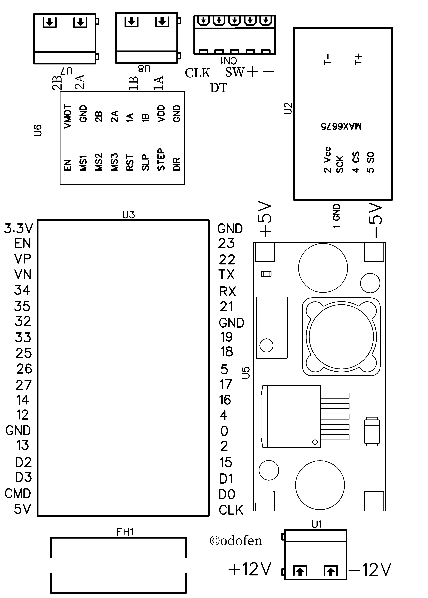
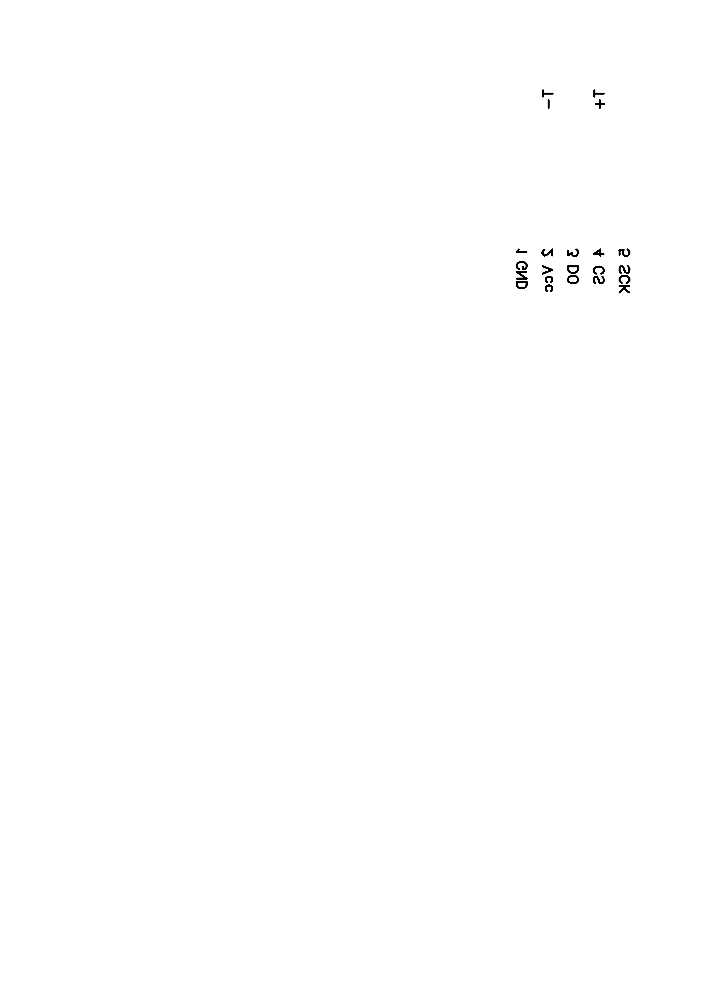

# Ofensteuerung v4

Luftklappensteuerung für einen Holzofen mit ESPHome und Home Assistant. Ein Schrittmotor stellt die Luftzufuhr,
geregelt wird nach der Abgastemperatur im Rauchrohr. **Im Einsatz und erprobt** (Heizsaison 2026).

Nachfolger mit eigener Platine, TMC2209 und Regelung direkt am Gerät: Ofensteuerung v5 (in Arbeit).

## Hardware
| Teil | Anschluss (ESP32 GPIO) |
|---|---|
| ESP32-DevKit (esp32dev) | – |
| Schrittmotortreiber A4988 (Vollschritt, keine MS-Jumper) | STEP 26, DIR 25, SLEEP 33 |
| Schrittmotor Nema 23, 2 A, an der Luftklappe | über A4988 |
| MAX6675 + Thermoelement Typ K im Rauchrohr | SCK 19, SO 17, CS 18 |
| Drehgeber (KY-040 o. ä.) | A 35, B 32, Taster 13 |
| Status-LED | 2 |

### Platine
Eigene Trägerplatine (EasyEDA, Jänner 2025, gefertigt bei JLCPCB) für ESP32-DevKit, A4988, MAX6675-Modul,
Spannungsregler 12 V → 5 V, Sicherungshalter und Schraubklemmen (12 V, Motor 2B 2A 1B 1A, Drehgeber CLK DT SW + −).

| | |
|---|---|
|  |  |

Fertigungsdaten: [`hardware/ofensteuerung-v4-gerber.zip`](hardware/ofensteuerung-v4-gerber.zip) (direkt bei JLCPCB hochladen),
einzeln in `hardware/gerber/`.

GPIO 34–39 haben keinen internen Pull-up: Hat das Drehgeber-Modul keinen, 10 kΩ nach 3,3 V an GPIO 35.

Klappenstellung in Schritten: **0 = zu, 2100 = offen**, Drehgeber und Slider in 25er-Schritten.

## Dateien
| Datei | Inhalt |
|---|---|
| `esphome/ofensteuerung-v4.yaml` | ESPHome-Firmware |
| `hardware/` | Platine: Gerber-Dateien und Vorschaubilder |
| `esphome/secrets.example.yaml` | Vorlage für die `secrets.yaml` |
| `homeassistant/script_ofen_abbrand_regeln.yaml` | Regelung eines Abbrands (Skript) |
| `homeassistant/automation_ofensteuerung_taster.yaml` | Taster am Gerät startet/stoppt die Regelung |
| `homeassistant/script_ofen_anheizen_starten.yaml` | Dashboard-Button „Anheizen“ |
| `homeassistant/helfer_ofen_temperatur_max_15_min.yaml` | Statistik-Helfer 15-min-Maximum (für das Regelskript) |
| `homeassistant/dashboard_ofen.yaml` | Dashboard-Ansicht „Ofen“ |
| `homeassistant/automation_klima_ofen_lueften.yaml` | optional: Klimaanlage verteilt die Ofenwärme |

### Einrichtung in Home Assistant
1. ESPHome-Gerät einbinden (`esphome/ofensteuerung-v4.yaml`).
2. Statistik-Helfer anlegen (`homeassistant/helfer_ofen_temperatur_max_15_min.yaml`).
3. Skripte `ofen_abbrand_regeln` und `ofen_anheizen_starten` anlegen, dann die Automation „Ofensteuerung Taster“.
4. Optional: Dashboard-Ansicht und „Klima Ofen Lüften“.

Das Regelskript braucht außerdem einen Außentemperatur-Sensor (hier `sensor.gw1200a_outdoor_temperature`).
Die Entitäts-IDs in den Dateien an die eigene Installation anpassen.

## Firmware
- Taster am Drehgeber: **1× = Anheizen** (Klappe 2100), **2× = Nachlegen** (1000), **lang = Handstellung** (1050).
  Jeder Klick löst zusätzlich das Event „Taster“ aus, das in Home Assistant die Regelung startet oder stoppt.
- Drehgeber: Klappe in 25er-Schritten.
- Nach einem Neustart fährt der Motor nicht los, die gespeicherte Position wird übernommen.
- Referenz: Klappe von Hand schließen, Button „Stepper: Position als zu setzen“.
- Grenzen: Der A4988 meldet nichts zurück, verlorene Schritte werden nicht erkannt. Die „Crash-Erkennung“ im
  YAML erkennt keine mechanische Blockade.

## Regelung (Home Assistant)
1. **Anheizen:** Klappe offen, bis zu 90 min warten auf Abgas > 250 °C. **Nachlegen:** warten auf +50 K (max. 15 min).
2. **Flammphase:** 250–350 °C → 700, 350–450 → 500, 450–485 → 425, 485–520 → 375, über 520 → 300 (Notbremse).
   Die Klappe wird nur geschlossen, nie wieder geöffnet.
3. **Ende der Flammphase:** frühestens nach 35 min, wenn das Abgas unter 300 °C oder mehr als 100 K unter dem
   15-min-Maximum liegt. Nach einem Treffer wird 3 min gewartet und erneut geprüft, damit ein einzelner Messwert
   nicht reicht. Sofort bei < 200 °C oder nach 3 h.
4. **Glutphase:** 450, unter 250 °C → 300.
5. **Ausbrand:** unter 150 °C → 200 (bei Frost 300).

## Erfahrungen aus den Abbränden
- Zu frühes, starkes Schließen nach der Spitze löst selbst einen steilen Temperaturabfall aus und kann das Feuer
  ersticken. Deshalb: Mindestdauer der Flammphase, 100-K-Kriterium statt 50 K und 3-min-Bestätigung.
- Der direkte Sprung 500 → 375 verursachte Einbrüche um ~140 K, die Zwischenstufe 425 verhindert das.
- Die Glut braucht anfangs noch Luft (CO), daher 450 statt sofort 300.

## Lizenz
MIT, siehe [`LICENSE`](LICENSE).
